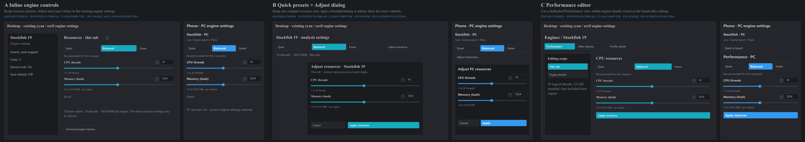

# Device-balanced engine resources: three layout options

Novelty b186d2d7 adds Quiet/Balanced/Faster CPU and hash-memory presets, device
recommendations, sliders and exact fields, while preserving saved search choices.
En's native engine form currently has thread segments and a hash slider; its
phone PC controls have four fixed resource presets. These editable alternatives
use the existing native serif/cyan and phone sans-serif/blue controls. All shown
hardware, values and state examples are invented. No application is rendered or
changed by these static prototypes.

- **A — Inline engine controls (recommended):** keep presets and sliders in the
  existing per-engine settings. A completed edit or preset selection applies
  once; no additional confirmation. [Editable workflow](a-workflow.svg).
- **B — Quick presets + Adjust dialog:** keep a compact preset row and current
  resource summary. Exact controls open in a bounded desktop dialog or phone
  sheet; Cancel discards its draft and Apply commits it once.
  [Editable workflow](b-workflow.svg).
- **C — Performance editor:** a dedicated Performance view inside engine details
  separates resource editing from the live board. Scope is explicit; Apply
  commits its draft and Back returns without changing it.
  [Editable workflow](c-workflow.svg).

Each sheet covers desktop, phone and 320px controls, plus first use, existing
saved/custom values, loading/unavailable device, application progress, failures/
retry/restore, gesture cancellation, scope changes, engine Off/offline, help,
unsupported engine options and changed-owner confirmation. The detailed
[state map](STATE_MAP.md) is shared by all three directions.

The native form's existing per-tab/default synchronization stays explicit.
Phone PC resources must use PC capabilities, never phone hardware. The managed
single-thread phone engine and LCZero GPU resources retain their own supported
controls. Saved legacy resource choices remain authoritative; a recommendation
is not permission to rewrite them. Search limits and lines are independent.

Text widths are measured against installed Times/Segoe fonts. SVGs are parsed
and rasterized with the existing offline renderer for visual review, without
browser or native app control. These are editable design artifacts, not evidence
of rendered application interactions or physical-device verification.

Direction selection is pending. The device snapshot and pure budget behavior can
be developed independently; do not implement a final control layout until the
owner chooses a direction. The approved evaluation Settings A and phone Analysis
A remain their own decisions and are not reopened by this new resource editor.
